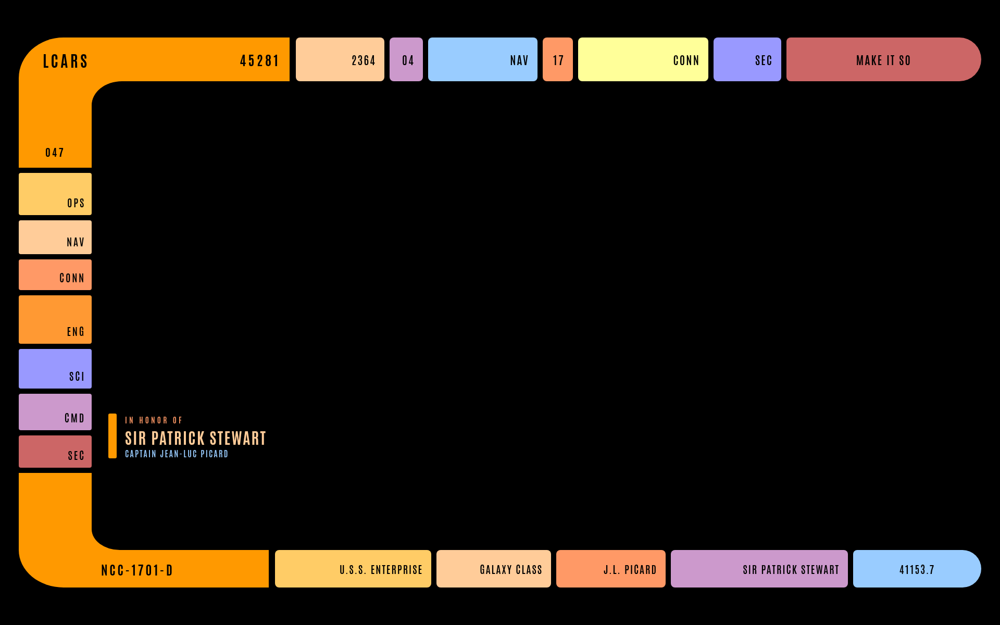
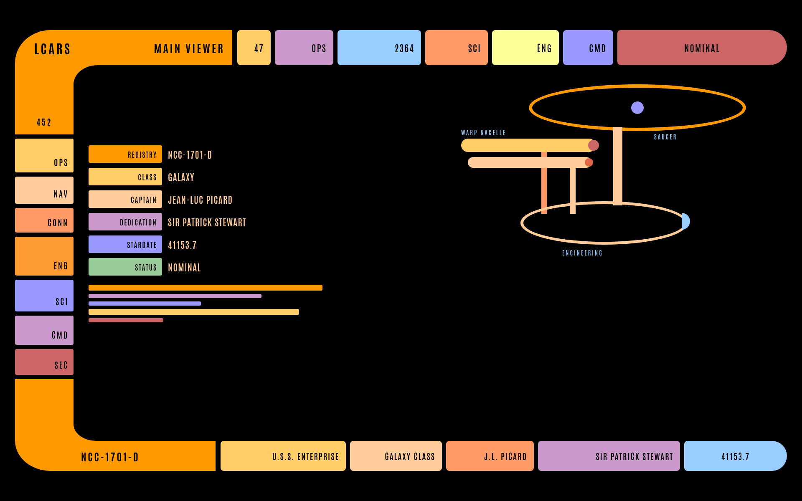
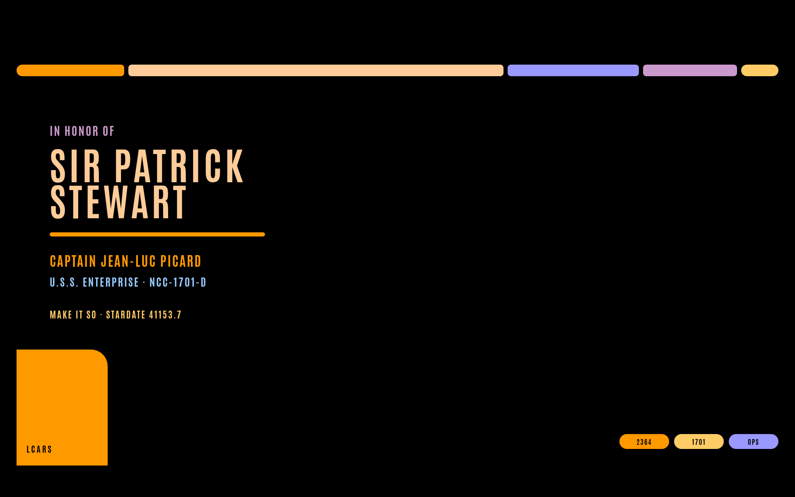

# LCARS

An [Omarchy](https://omarchy.org/) theme in the style of the LCARS panels from *Star Trek: The Next Generation*. The palette is Michael Okuda's 2369 set: a black field, atomic tangerine (`#ff9900`), and tanoi text (`#ffcc99`).

The wallpapers use the television elbow frame, with station buttons down the left rail and the ship's name on the bottom bar. The ready room wallpaper is dedicated to Sir Patrick Stewart. Fastfetch gets a gold Starfleet insignia, and the screensaver names the *U.S.S. Enterprise*, NCC-1701-D, at stardate 41153.7.

## Screenshots

Bridge



Main viewer



Ready room



## Install

```bash
omarchy theme install https://github.com/linuxg33k76/omarchy-lcars-theme.git
```

Omarchy clones the repo as the `lcars` theme and applies it. Cycle the wallpapers with `omarchy theme bg next`.

`colors.toml` drives the terminal, the shell, and the window colors. The shell files set the bar, launcher, lock screen, menu, notifications, polkit prompt, popups, and tooltips. Icons follow Yaru-yellow.

`hyprland.lua` adds a thicker border, rounded corners, and an orange shadow. Omarchy does not load `.lua` from a theme installed with `omarchy theme install`, so that file is skipped on the path above. Border color still comes from `colors.toml`. To keep `hyprland.lua`, point the theme directory at your own checkout:

```bash
git clone https://github.com/linuxg33k76/omarchy-lcars-theme.git ~/code/omarchy-lcars-theme
ln -sfn ~/code/omarchy-lcars-theme ~/.config/omarchy/themes/lcars
omarchy theme set lcars
```

## Fastfetch logo

Omarchy reads the logo from `~/.config/omarchy/branding/about.txt`. Copy this theme's file there:

```bash
cp ~/.config/omarchy/themes/lcars/about.txt ~/.config/omarchy/branding/about.txt
```

The drawing uses fastfetch color slots. Stock Omarchy only sets slot 1, so add the golds under `logo.color` in `~/.config/fastfetch/config.jsonc`:

```jsonc
"2": "#ffcc99",
"3": "#ffcc66",
"9": "#ffff99"
```

## Screensaver

```bash
cp ~/.config/omarchy/themes/lcars/screensaver.txt ~/.config/omarchy/branding/screensaver.txt
```

Preview it with `omarchy-launch-screensaver force`. It runs in Alacritty, Ghostty, Foot, or Kitty.
